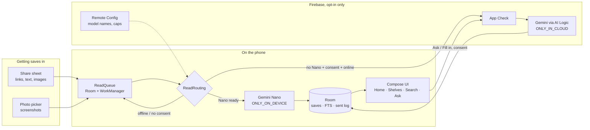

# Kept

**Screenshots and saves, read into searchable cards, on any Android phone.**

People screenshot and share things they mean to come back to: a recipe reel, five movies a friend posted, a café in Goa,
an event poster, an app to try. Then those saves sink into a camera roll of thousands. Kept reads each screenshot or
shared link into a card (title, summary, type, tags, the items inside it, place, date, link), sorts the cards onto shelves
named after what *you* save, and lets you search them or ask questions about them.

The reading is **hybrid, through Firebase AI Logic**:

- On a phone with **Gemini Nano**, every screenshot is read **on the device**. Private screenshots never leave the phone,
  and reading works in airplane mode.
- On a phone without Nano (most phones today), the person can **opt in** to cloud reading with Gemini. Until they say
  yes, nothing leaves the phone and saves wait, or can be tagged by hand.
- **Ask** ("which of my saves are about cooking?") and **Fill in** (complete a thin card) are always cloud, always
  behind consent, and every cloud request is listed word for word in a **Sent log** in the app.

Built for the #BuildHybridAI hackathon (Nov 2026). Licence: Apache-2.0.

## Try it

- **Google Play:** [Kept: Save, Sort, Search](https://play.google.com/store/apps/details?id=com.jdevsappstudio.kept)
  (free, no ads, no sign-in).
- **APK:** the latest [GitHub release](https://github.com/jdevsappstudio-github/kept/releases) has the Play-signed APK.
  Install it on Android 8.0+ (allow installs from your browser or file manager).

Every feature is free and unlocked. Cloud use has a daily cap so one person can't drain the shared quota: 100 cloud reads
and 20 answers a day, reset at midnight.

A quick tour: share a link or pick a few screenshots (+ button) → watch them read into cards → open **Shelves** → search
for a word that only appears inside a screenshot → **Ask** a question → tap the **Cloud** chip on an answer to see
exactly what was sent. No content of your own? Tap **Try 3 examples** on the empty Home screen.

## How Kept uses Firebase AI Logic

All AI goes through the Firebase AI Logic SDK (`com.google.firebase:firebase-ai` + `firebase-ai-ondevice`), Gemini
Developer API backend, protected by **Firebase App Check** (Play Integrity in release builds, the debug provider in
debug builds). There is no ML Kit OCR, no bundled model and no server of our own.

| Job | Where it runs | Model | Code |
|---|---|---|---|
| Read a screenshot / link into a card | **On device** when Nano is ready (`InferenceMode.ONLY_ON_DEVICE`) | Gemini Nano (stable option) | [`FirebaseCardReader`](app/src/main/java/com/jdevsappstudio/kept/data/ai/FirebaseCardReader.kt) |
| Same job, phone without Nano | **Cloud**, only after the person turns on cloud help (`ONLY_IN_CLOUD`) | Gemini 3.5 Flash-Lite, minimal thinking; busy → retry once → cheaper fallback | same |
| Ask about your saves | Cloud, consent-gated | Gemini 3.5 Flash-Lite, low thinking | [`FirebaseCloudAsker`](app/src/main/java/com/jdevsappstudio/kept/data/ai/FirebaseCloudAsker.kt) |
| Fill in a thin card | Cloud, consent-gated | as Ask | [`PageFiller`](app/src/main/java/com/jdevsappstudio/kept/data/ai/PageFiller.kt) |
| Download Nano | On device (`onDeviceExtension.download()`) | — | [`DeviceModelDownloads`](app/src/main/java/com/jdevsappstudio/kept/data/ai/DeviceModelDownloads.kt) |

Details that matter:

- **Structured output both ways.** Cards and answers are `@Generable` Kotlin classes read with `generateObject(schema, …)`,
  so the on-device and cloud models return the same typed `CardDraft`. The UI never parses free text.
- **The route is decided per read and shown to the person.** [`ReadRouting`](app/src/main/java/com/jdevsappstudio/kept/data/queue/ReadRouting.kt)
  picks `DEVICE` (Nano ready), `CLOUD` (no Nano, cloud help on, online), `OFFLINE` (wait for the network) or
  `NEEDS_CONSENT` (wait for a yes). The same value drives the share-sheet line and the Home status strip, so the app
  never claims "on this phone" when it isn't. Each card records which engine read it (`InferenceSource`).
- **The device model is one `GenerativeModel` with `ONLY_ON_DEVICE`;** each cloud preset gets its own `ONLY_IN_CLOUD`
  instance, because the inference mode is set per model, not per request.
- **Model names and thinking levels come from Remote Config** (`RemoteValues`) with code defaults, so a model can be
  swapped without a release.
- **Search is local.** Full-text search over titles, summaries, tags and the items read out of each screenshot (Room FTS),
  so finding things costs no AI calls at all.

## Architecture



Single `:app` module, layered by package: `data/` (AI, queue, Room, search, quota, sent log), `feature/` (one package per
screen, MVI: State / Action / ViewModel / Root + Screen composables), `core/` (design system, models), Koin for DI,
type-safe Compose Navigation. ~300 JVM unit tests plus Room/library device tests.

## Build from source

Requirements: Android Studio with AGP 9.2, JDK 21, Android SDK 36.

1. Create a Firebase project and add an Android app with package `com.jdevsappstudio.kept` (debug and release share it).
2. In the console, enable **Firebase AI Logic** with the **Gemini Developer API**.
3. Download `google-services.json` into `app/`. (It is gitignored. Without it the app still builds and runs, and says
   AI is not set up.)
4. `./gradlew :app:installDebug`

### App Check (debug builds)

Debug builds use `DebugAppCheckProviderFactory`. On first launch the app logs a token:

```
adb logcat -s DebugAppCheckProvider
# Enter this debug secret into the allow list in the Firebase Console for your project: 1a2b3c4d-....
```

In the Firebase Console → **App Check** → your Android app → **Manage debug tokens**, add that token. Then turn on App
Check enforcement for **Firebase AI Logic** (Gemini Developer API). Clearing the app's data creates a new token.

Release builds use Play Integrity; register your signing certificate's SHA-256 in the Firebase app settings. If you
publish with Play App Signing, register **every** app-signing key Play shows (with quantum-ready signing that is the new
key *and* the previous classical key, which older Android versions still receive).

### Gemini Nano

On-device reading needs a phone where AICore offers Gemini Nano to third-party apps. Kept checks
`onDeviceExtension.checkStatus()` at onboarding and offers the download (`DOWNLOADABLE` → progress → ready). Without
Nano the app runs fully on the cloud path once you allow it.

## Privacy

No accounts, no analytics, no ads. Saves live in the app's private storage. Nothing is sent anywhere unless the person
turns on cloud help, and every cloud request is shown in the Sent log. See [PRIVACY.md](PRIVACY.md) and the
[privacy policy](https://jdevsappstudio.com/kept/privacy-policy.html).

## Built during the hackathon

Kept grows out of an earlier private prototype of a screenshot organizer by the same developer, which used ML Kit OCR
and a local embedding model. That approach was dropped: this repository was started fresh on 25 Nov 2026, and the
Firebase AI Logic hybrid reader, the design, the data layer and every screen here were built during the hackathon.
AI coding assistants were used, as the rules allow.

## Licence

Apache-2.0, see [LICENSE](LICENSE).
